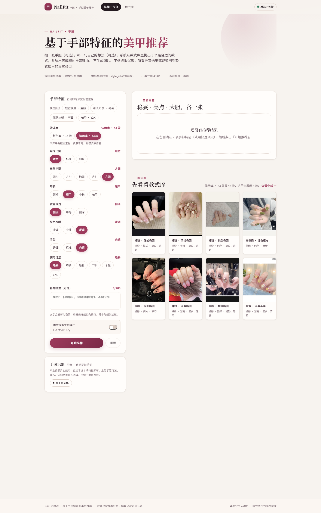
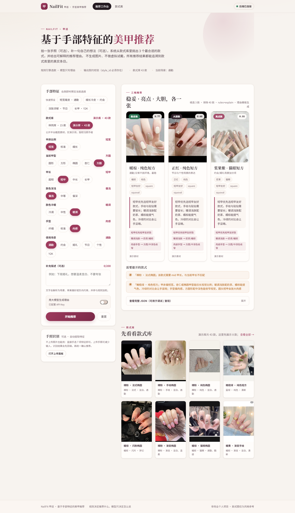
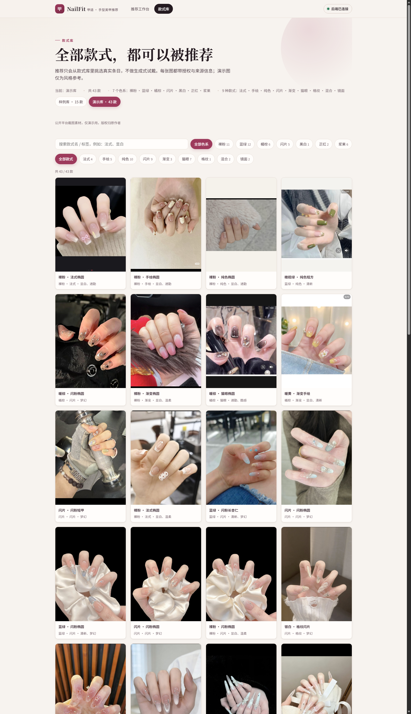
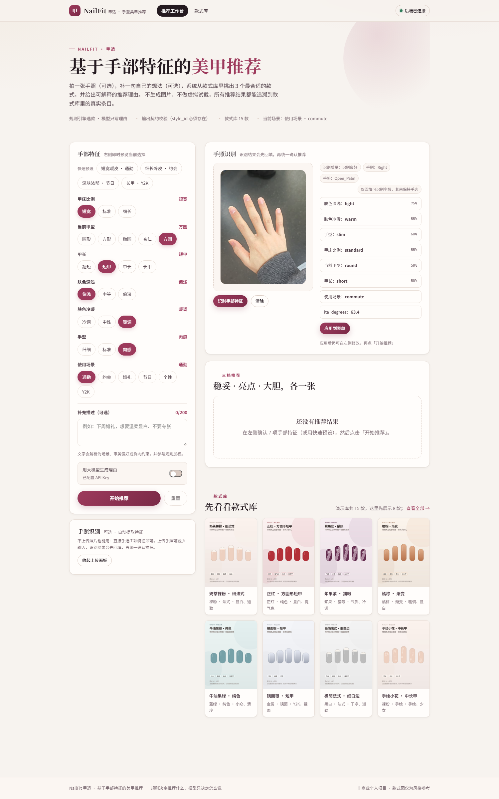

# NailFit 前端（Vue 3 + Vite + TypeScript）

NailFit（甲适）的 Vue 前端：手部特征录入 → 规则引擎推荐 → 三档可解释结果，另含手照识别与款式库浏览。

后端是 `C:\Users\lenovo\Desktop\nailfit` 里的 FastAPI 服务；前端只通过 HTTP 调接口，图片由后端 `/static` 提供，因此**两边都启动后图片才能正常显示**。

## 快速开始

### 1. 启动后端（必须先启动）

```powershell
conda activate nailfit
cd C:\Users\lenovo\Desktop\nailfit
python -m uvicorn api.main:app --reload --port 8000
```

看到 `Uvicorn running on http://127.0.0.1:8000` 即成功；接口文档在 <http://127.0.0.1:8000/docs>。

### 2. 启动前端

```powershell
cd C:\Users\lenovo\Desktop\naifit-fonted
pnpm install
pnpm dev
```

浏览器打开 <http://127.0.0.1:5173>。

开发模式下 Vite 会把 `/api` 与 `/static` 代理到 `127.0.0.1:8000`（见 `vite.config.ts`），所以前端用相对路径即可，后端也无需额外配 CORS。

### 3. 生产构建 / 本地预览

```powershell
pnpm build        # 产物在 dist/
pnpm preview      # http://127.0.0.1:4173
```

部署到独立域名时，把后端地址写进 `.env`：

```ini
VITE_API_BASE=https://api.example.com
```

此时后端需要允许前端域名跨域（FastAPI 加 CORSMiddleware），且 `/static/*` 也要能跨域访问。`pnpm preview` 同样需要把 `/api`、`/static` 指到后端（可在 `vite.config.ts` 里给 `preview.proxy` 也加一份，或直接配 VITE_API_BASE）。

## 功能

- **推荐工作台**
  - 7 项手部特征（甲床比例 / 甲型 / 甲长 / 肤色深浅 / 冷暖 / 手型 / 场景），chip 点选
  - 4 组快速预设（短宽暖皮通勤、细长冷皮约会、深肤浓郁节日、长甲 Y2K）
  - 补充文字描述（场景 / 审美 / 负向避雷），参与规则加权
  - 可选「用大模型生成理由」；后端无 Key 时自动退回模板，不会报错
  - 三档结果卡（稳妥 / 亮点 / 大胆）：匹配度、命中规则、推荐理由、避雷提示、图片来源
  - 完整 JSON 展开 / 复制 / 下载，方便复现与调试
- **手照识别**：拖拽或点击上传手照（≤12 MB），调用 `POST /api/vision/upload`，展示识别质量、手别、手势与各字段置信度；可一键回填表单（低置信字段会标注）
- **款式库**：全部款式网格，按色系 / 款式筛选 + 关键词搜索，显示授权与来源说明
- **款式库切换**：可选样例库（15 款占位图）或演示库（43 款真实截图），切换后图廊与推荐结果同步更新
- 后端健康状态实时指示（顶部右上角），断连时给出明确提示

## 截图

| 工作台 | 三档推荐 |
| --- | --- |
|  |  |

| 款式库（演示库 43 款） | 手照识别 |
| --- | --- |
|  |  |

## 目录结构

```
naifit-fonted/
├─ index.html
├─ vite.config.ts          # /api /static 代理到 127.0.0.1:8000
├─ src/
│  ├─ main.ts
│  ├─ router.ts            # hash 路由：/ 工作台、/library 款式库
│  ├─ api.ts               # fetch 封装、超时、ApiError、assetUrl、downloadJson
│  ├─ types.ts             # 与 FastAPI 响应一一对应的类型
│  ├─ options.ts           # 枚举中文标签、预设、规则名翻译
│  ├─ styles.css           # 设计系统（暖纸底 + 梅红主色）
│  ├─ App.vue
│  ├─ components/
│  │  ├─ AppHeader.vue     # 导航 + 后端健康检查
│  │  ├─ FeatureForm.vue   # 特征录入 + 预设 + 文字 + LLM 开关
│  │  ├─ PhotoUpload.vue   # 手照上传识别
│  │  ├─ ResultBoard.vue   # 三档推荐结果 + 避雷 + JSON
│  │  └─ StyleGallery.vue  # 款式网格（可选筛选）
│  └─ views/
│     ├─ WorkbenchView.vue
│     └─ LibraryView.vue
└─ .env.example
```

## 与后端的接口约定

| 方法 | 路径 | 用途 |
| --- | --- | --- |
| GET | `/api/health` | 健康检查 |
| GET | `/api/styles?library=sample\|demo` | 款式库（`{ count, styles }`，默认 sample） |
| POST | `/api/recommend` | 推荐（`features` + `free_text` + `use_llm` + `library`） |
| POST | `/api/vision/upload` | 手照识别（原始图片字节，`?scene=commute`） |

图片字段（`image`、`media.image`）是相对路径，如 `static/styles/s001.jpg`，通过 `assetUrl()` 拼成同源 URL。

## 说明

- 纯前端不保存任何数据，不上传照片到第三方；识别在后端本地完成。
- 款式图仅作风格参考，非本手模拟效果；演示图版权归原作者。
- 本目录独立于后端仓库，可单独部署；接口契约见后端 `README.md` 与 `api/schemas.py`。
